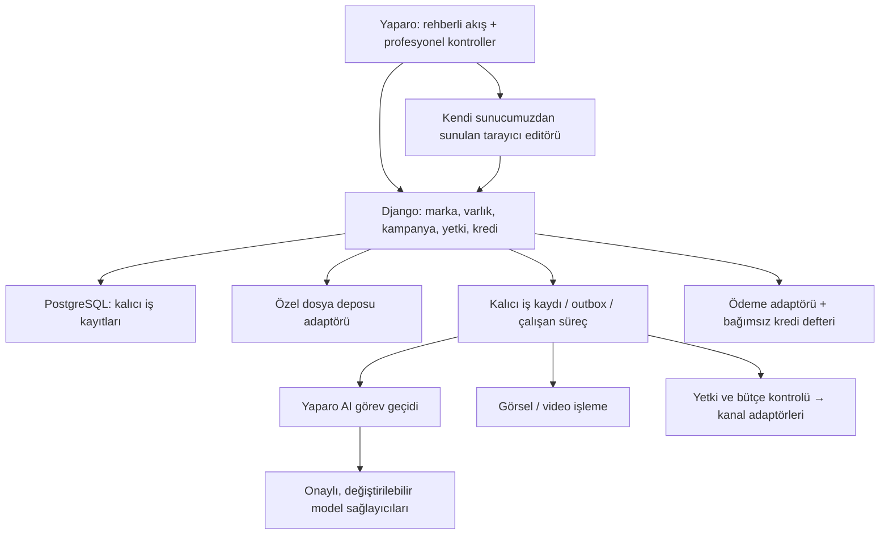

# Yaparo: açık kaynakla sürdürülebilir ürün planı

Tarih: 23 Ekim 2026, Europe/Istanbul. Durum: kullanıcının yön değişikliği talebine dayanan uygulama planı; bileşenler aşağıdaki denemelerden geçmeden üretim seçimi sayılmaz. [ADR-0040](../adr/0040-owned-core-and-open-source-adoption.md), [repo araştırması](open-source-candidate-research.md) ve [iş sırası](yaparo-delivery-plan.md) birlikte okunur.

## 1. Ürün kararı ve bağımsızlığın ölçüsü

Yaparo, Türkiye'de farklı sektörlerden reklamverenlerin marka ve tekliflerini anlatıp içerik hazırlayabildiği, mevcut içeriklerini geliştirebildiği, yetkilendirdiği hesaplarda reklam yönetebildiği ve sonuçlarını anlayabildiği bir hizmettir. Başlangıç seviyesindeki kullanıcıya rehberli akış, profesyonele aynı kayıtlar üzerinde ayrıntılı kontrol sunar. Normal işlemde Yaparo personeli onayı gerekmez; eksik bilgi, izin veya belirsiz sonuç varsa kullanıcıya açıklanarak durulur.

Yeni geliştirme ilkesi: standart yeteneklerde uygun açık kaynak bileşeni kullan; marka, müşteri deneyimi, reklam iş kuralları, veri ve parasal kayıtların sahibi Yaparo olsun. Django/PostgreSQL korunur. Bütün bir ürünü çatallayıp adı değiştirilmez; araştırmada uçtan uca gereksinimlerimizi karşılayan, lisansı ve işletimi uygun tek platform doğrulanmadı.

Bağımsızlık için kabul ölçütleri:

- Uygulama, temel editör ve dosyalar seçtiğimiz sunucuda çalışabilir; zorunlu bir editör/ajan SaaS hesabı yoktur.
- Bir müşteri projesi kaynakları, düzenlenebilir tasarımı, sürümleri ve izin verilen raporlarıyla dışa aktarılıp geri alınabilir.
- AI sağlayıcısı değişimi web formlarını, kampanya kimliklerini, müşteri kredi defterini veya bütün veritabanını yeniden yazdırmaz.
- AI bağlantısı kesildiğinde mevcut materyalde yazı, boyut, yerleşim, renk ve kırpma düzenlemeleri ve uygun dışa aktarma çalışır.
- Bulut taşıma için uygulama paketi, standart PostgreSQL yedeği, dosya manifesti ve güvenli sır taşıma prosedürü vardır; geri dönüş denemeyle kanıtlanır.
- Reklam ağı, ödeme kuruluşu ve seçilmiş uzaktaki AI hizmeti dış bağımlılık olarak kaydedilir. API izni veya model erişimi olmadan aynı hizmetin süreceği vaat edilmez.

Bu plan mevcut üretim/gerçek veri/yayın/harcama kapılarını açmaz. Google TEST kayıtları, durdurma/uzlaştırma davranışı ve korunan yetki adayının geçmişi yeniden oluşturulmaz veya sıfırlanmaz. Tamamlanmış testler ürünün tamamlandığı anlamına gelmez.

## 2. Arz ve talep: neyi doğrulamamız gerekiyor?

IAB'nin 28 Nisan 2025 tarihli 2024 Türkiye bülteni dijital medya yatırımını yaklaşık 158 milyar TL, dijitalin medya içindeki payını %74,2, dijital içinde sosyal payını %47,08 ve mobil payını %79,4 olarak bildiriyor. 7 Temmuz 2026 tarihli Avrupa 2025 özeti Türkiye'yi altı büyük dijital pazar arasında gösteriyor. Bunlar mobil önizleme ve sosyal görsel ihtiyacını destekleyen pazar işaretleridir; Yaparo için ödeme isteği veya müşteri problemi doğrulaması değildir. Nominal TL büyümesi gerçek büyümeyle karıştırılmaz. Kaynaklar: [Türkiye 2024 bülteni](https://iabtr.org/basin/turkiye-2024-yili-tahmini-medya-ve-reklam-yatirimlari-aciklandi/), [Avrupa 2025 özeti](https://iabtr.org/rapor/iab-avrupa-adex-benchmark-2025/).

| İlk araştırma grubu | Müşterinin işi | Yaparo'da doğrulanacak değer | İlk sınır |
|---|---|---|---|
| Mevcut sitesi olan yerel hizmet işletmesi | Belirli bölgede uygun teklif/iletişim talebi almak | Anlaşılır plan, sınırlı bütçe, doğru Search metni ve ölçülebilir sonuç | İlk ücretli reklam kanalı Google Search; düzenlemeye tabi yüksek riskli sektörler ayrıca değerlendirilir |
| Ürün fotoğrafı olan küçük satıcı | Mevcut görselleri marka uyumlu reklam varyantlarına dönüştürmek | Hızlı düzenleme, tekrar kullanım, açık üretim maliyeti | Önce içerik stüdyosu ve dışa aktarma; katalog reklamı/Meta yayını ayrı aşama |
| Küçük ajans/profesyonel reklamveren | Çok sayıda marka ve varyantı yönetmek | Sürüm, toplu işlem, rapor karşılaştırması, müşteri erişimi | Önce tasarım ortağı; tam ajans paketi ilk sürüme yüklenmez |

Araştırma hedefi: her gruptan dört kişiyle toplam 12 görüşme; altı gözlemlenen prototip oturumu (en az üç başlangıç kullanıcısı); uygun yayın kapıları sonrası 3–5 pilot müşteri. Bunlar henüz yapılmadı. Görüşmeler mevcut kampanyanın nasıl hazırlandığını, revizyon yükünü, materyal eksiklerini, rapor yorumunu ve harcama kararını inceler. Gerçek materyal almak ve kişilerle iletişime geçmek ayrı izin/veri koşullarına tabidir.

İlk kullanılabilirlik hedefi: altı kişinin en az beşi sentetik örnekte yardım almadan taslağı düzenleyip dışa aktarabilsin; ilk düzenlenebilir içeriğe hedef süre 10 dakika; hiçbiri içerik kredisi, Yaparo hizmet bedeli ve medya bütçesini karıştırmasın. Bu eşikler Yaparo'nun önerilen kabul ölçütleridir, sektör standardı veya tamamlanmış sonuç değildir. Ödeme isteği, tekrar kullanım, kabul edilen içerik başına maliyet ve nitelikli talep tanımı pilotta ölçülür.

## 3. Kullanıcıya sunulacak hizmet ve uçtan uca akış

İki eşit giriş kapısı vardır: **benim için içerik üret** ve **elimdeki içeriği kullan/geliştir**. Kullanıcı üretim satın almadan mevcut uygun içeriğini reklamda kullanabilmelidir.

1. Kayıt/işletme: marka, dil, hedef, teklif, konum ve mevcut hedef site; yalnız gereken bilgiler istenir.
2. Marka kiti: logo, renkler, izinli yazı tipleri, ürün/hizmet gerçekleri, kanıtlı iddialar ve yasak ifadeler saklanır.
3. Materyal: desteklenen dosya, kullanım hakkı ve işleme izniyle alınır; orijinal korunur, dosya güvenlik kontrolünden geçer.
4. Plan: hedef, kanal, kapsam, süre ve ayrı maliyetler gösterilir. Eksik bilgi tahmin edilip gerçek diye yazılmaz.
5. Üret/düzenle: metin önerileri ve gerekirse yeni görsel; müşteri metni, fiyatı, logosu ve yerleşimi ayrı düzenlenebilir katmanlardır.
6. Önizle: seçilen kanalın ölçü/metin/politika sınırları, mobil görünüm, hedef URL ve olgusal dayanaklar kontrol edilir.
7. Ticari onay: üretim kredi bedeli, Yaparo kampanya hizmeti ve platforma ödenecek medya harcaması ayrı ayrı gösterilir.
8. Hesap/onay: kullanıcı kendi reklam hesabını bağlar; kesin içerik sürümü, hedef, süre, bütçe ve otomasyon sınırını onaylar.
9. Yürütme: iş kuyruğu ilerleme/hata/durdurma durumunu açıklar; belirsiz API yanıtı tekrar reklam oluşturmaya dönüşmez.
10. Ölçüm: kaynak, zaman aralığı, gecikme, dönüşüm tanımı ve veri eksikleriyle sonuç gösterilir.
11. İyileştirme: yeterli kanıt varsa öneri veya önceden izin verilmiş sınırlı deney yürütülür; harcama artışı gizlice yapılmaz.
12. Çıkış: bağlantı kesme, iş durdurma, veri dışa aktarma/silme ve borç/iade uzlaştırması ayrı anlaşılır işlemlerdir.

İlk teslim: marka + metin + sabit görsel tasarım + düzenleme/dışa aktarma. İlk yayın: Google Search. Görsel stüdyosunun tamamlanması Google Search'ün her yerleşimde aynı görseli kullanacağı anlamına gelmez. Meta ücretli reklamları görsel yayın genişlemesi olarak daha sonra gelir. Organik sosyal takvim ilk ücretli reklam ürününe zorunlu bağımlılık yapılmaz.

### Markaya özel deneyim — 23 Ekim kapsam netleştirmesi

Bir kullanıcı birden fazla markayı yönetebilir. Her markanın ayrı kimliği,
karakteri, renk/logo/font kuralları, doğrulanmış gerçekleri, içerik kütüphanesi ve
tercih geçmişi vardır. Temel çok markalı deneyim Y04'te başlar; Y29'a ertelenmez.
Marka/kimlik sürümü üretim işi, tasarım ve kampanyaya bağlanır; erişim sunucuda
kontrol edilir ve marka değişimi devam eden işi başka markaya taşımaz.
[Marka deneyimi gereksinimleri](brand-specific-experience.md) hafıza, özgünlük,
sohbetle düzenleme, çok format ve senaryolu video deneylerinin kabul sınırlarını
belirler. Bunlar henüz uygulanmış değildir; kesin özgünlük/performans vaadi yoktur.

## 4. Kendi sistemimizde editör ve materyal kütüphanesi

İlk aday bileşim Fabric.js + Uppy + Pillow'dur. Fabric ile küçük Yaparo editörü ve bir hazır MIT editör aynı örnek üzerinde karşılaştırılır; seçim deneme sonunda kaydedilir. Konva yedek adaydır, aynı ekran için iki canvas kütüphanesi kurulmaz. Kaynak/lisans ayrıntısı [araştırma tablosunda](open-source-candidate-research.md).

İlk araçlar: resim kırpma/döndürme/yeniden boyutlandırma, katman sırası, hizalama, metin, logo, renk, şablon, geri al/yeniden yap, kopyalama, kare/dikey format ve PNG/JPEG dışa aktarma. Türkçe karakter, metin taşması, kontrast, güvenli alan, mobil sadeleştirme ve klavyeyle katman/özellik kontrolü kabul koşuludur. Sık yapılan bu işlemler AI çağrısı veya üretim kredisi gerektirmez; servis kotası varsa ayrıca açıkça tanımlanır.

Yaparo'nun sürümlü tasarım belgesi: `schema_version`, tuval ölçüsü, katman kimlikleri, asset sürüm referansları, yazı tipi/renk/transform/kırpma ve marka kuralları. Editörün özel JSON'u tek kalıcı veri biçimi olmaz. Orijinal, tasarım belgesi, önizleme ve dışa aktarılan resim ayrı tutulur. Render sürümü ve font sürümü/hash'i çıktıya bağlanır. Dönüşüm öncesi belge korunur; desteklenen upgrade ve önceki okunabilir sürüme geri dönüş denenir. Her gelecek şemanın kayıpsız aşağı dönüştürülebileceği vaat edilmez.

AI tüm başlığı ve fiyatı tek resme gömmek yerine arka plan/ürün görseli veya doğrulanabilir düzenleme önerisi üretir. Kullanıcının yaptığı değişiklikler yeniden üretimde kaybolmaz; seçilen katman/hedef için değişiklik karşılaştırması gösterilir. Ürün rengi/özelliği gibi maddi değişiklikler ayrıca doğrulanır.

İlk alım yalnız JPG/PNG/WebP ve elle girilen marka gerçekleriyle sınırlıdır. PDF/DOCX metin çıkarma ikinci dilimde Docling gibi bir adayla; OCR/model hakları ayrı incelenerek yapılır. SVG/HTML/script/uzak URL ithali varsayılan kapalıdır. PSD/AI/PDF'nin eksiksiz düzenlenebilir içe aktarımı vaat edilmez. Video sonraki aşamada kısa klip kesme, boyutlandırma, yazı/logo/altyazı ve izinli ses ile sınırlı başlar; FFmpeg izole çalışır ve kullanılan ikilinin lisansı denetlenir.

Dosyalar özel depoda, sahip ve sürüm kimliğiyle erişilir. Boyut/piksel/süre sınırı, MIME imzası, karantina, kaynak taraması, zararlı dosya kontrolü ve parser zaman/bellek sınırları gerekir. Dosya içindeki talimatlar sistem yetkisi kazanmaz. Model, font, stok görsel, müzik ve şablon hakları yazılım lisansından ayrıdır.

## 5. Hedef mimari ve taşınabilirlik

Bu hedef şemadır; kutuların tamamı mevcut uygulamada çalışmıyor. Web ve işçi aynı repo/domain kodunu paylaşır. Mikroservis, Kubernetes, vektör veritabanı veya genel amaçlı ajan ağı başlangıç zorunluluğu değildir.

| Modül | Yaparo'nun sahip olduğu kayıt/karar | Değiştirilebilir kısım |
|---|---|---|
| Kimlik ve çalışma alanı | Kullanıcı/üyelik/rol, müşteri izolasyonu, marka sahipliği | django-allauth gibi kimlik bileşeni |
| Materyal ve tasarım | Kaynak, izin, sürüm, kanıt, tasarım şeması | Uppy, canvas editörü, parser, renderer, storage |
| AI | Görev, veri sınıfı, kalite kuralı, maliyet rezervasyonu | SDK/kütüphane, model, sağlayıcı |
| Kampanya ve yayın | Hedef, bütçe, içerik onayı, dış işlem niyeti/geçmişi | Google/Meta/TikTok adaptörü |
| Ölçüm | Metrik anlamı, kaynak/dönem, atıf ve eksiklik | Kanal veri alma istemcisi |
| Ticaret | Fiyat teklifi, kredi hareketi, borç/iade | Ödeme kuruluşu istemcisi |
| İşletim | İş kimliği, tekrar önleme, olay/uyarı/uzlaştırma | Kuyruk, hosting, gözlemleme aracı |

Tarayıcı paketleri ve izinli fontlar kendi sunucumuzdan sunulur; çalışma anında zorunlu halka açık CDN kullanılmaz. Frontend için küçük derleme adımı eklenebilir; bu ayrı Next.js sunucusu gerektirmez. Browser editor ve backend arasında sürümlü API kullanılır.

Uzun AI/medya işleri gerektiğinde Celery ilk iş kuyruğu adayıdır; alternatif Dramatiq ile işletim ihtiyacı karşılaştırılır. Linux işçi, broker, özel dosya deposu ve gözlemleme maliyeti dağıtım öncesi hesaplanır. Windows'ta desteklenmeyen çalışma şekli üretim gibi sunulmaz; gerekirse aynı kaynağı kullanan Linux geliştirme ortamı tasarlanır. Şimdiki Heroku web+DB bütçesinin bütün bu bileşenleri kapsadığı varsayılmaz.

Üretim sır yönetimi yerel Windows DPAPI dosyalarına bağımlı olamaz. Anahtar yönetimi, tenant kapsamı, erişim kaydı, döndürme ve geri alma ayrı adaptör üzerinden tasarlanır. Eski teknik adları/kimlikleri marka değişikliği için dönüştürmek gerekmez.

## 6. AI ve yeni teknolojiye uyum

Web ekranı model adına bağlanmaz. `ad_copy_v1`, `image_generation_v1`, `image_edit_v1`, ileride `video_generation_v1` gibi görev/yetenek profilleri kullanılır. PydanticAI sınırlı tipli çıktı/sağlayıcı bileşeni olarak mevcut doğrudan adaptörle karşılaştırılır. Basit akış yeterliyse daha büyük çatı eklenmez. LangGraph karmaşık dallanma/devam gereksinimi, LiteLLM çok sayıda sağlayıcı rotası, Haystack gerçek belge arama ihtiyacı kanıtlandığında tekrar değerlendirilir.

Her görev sözleşmesi şunları taşır:

- Müşteri/çalışma alanı, görev kimliği, kaynak gerçekleri ve materyal sürümleri.
- Beklenen çıktı şeması; gerekli özellikler (görsel maske, saydamlık, çözünürlük, video süresi gibi).
- Veri sınıfı, izinli alıcı/bölge/saklama koşulu, hak beyanı ve son kullanım amacı.
- Model/profil ve prompt sürümü, süre, deneme sayısı ve maliyet tavanı.
- Sonuçta sağlayıcı iş kimliği, kullanım/maliyet durumu, kaynak/çıktı sürümü, doğrulama ve hata türü.

Ortak alanlar sabit tutulur; yeni sağlayıcı yetenekleri ad alanı belirlenmiş seçeneklerle eklenir. Desteklenmeyen yetenek sessizce daha düşük bir çıktıya dönüştürülmez. Yeni model adı aynı API'de çalışsa bile kalite, veri aktarımı ve maliyet koşulları yeniden incelenir.

Yeni sürüm süreci: keşfet → lisans/veri/özellik/maliyet kontrolü → temsili sentetik karşılaştırma → sınırlı aday kullanım → ölçüm → terfi veya geri dönüş. Son çalışan profil korunur. Yedek sağlayıcı yalnız önceden izinli veri koşulları ve maliyet sınırını sağlıyorsa devreye girer. Müşteri verisi otomatik olarak yeni bir şirkete gönderilmez.

Ölçüm kümesi en az iki hedef müşteri örneği, Türkçe karakterler, uzun metin, doğrulanmamış iddia, eksik fiyat, marka tutarlılığı, düzenleme koruması, bozuk çıktı, gecikme ve kesinti içerir. Ölçütler: kabul edilen içerik oranı, düzeltme süresi, olgusal hata, çıktı biçimi, süre ve **kabul edilen içerik başına toplam maliyet**. Modelin kendi puanı tek kalite kanıtı olamaz. Aynı görev/sürüm iki adaptörde yürüyebilmeli; eşdeğer kalite ayrıca ölçülür.

AI reklam yayımlama veya para artırma yetkisine sahip olmaz. Yeni araç/protokol desteği, örneğin MCP, doğrulanmış dar işlemlerle ayrı eklenebilir; üçüncü taraf ajana genel dosya/shell/ödeme/yayın yetkisi verilmez.

## 7. Reklam ağı, talep iletimi ve ölçüm

Google Search ilk kanal adayıdır. Mevcut PAUSED TEST kanıtı korunur. [Güncel Google erişim belgesi](https://developers.google.com/google-ads/api/docs/api-policy/access-levels) Cloud proje erişimini açıklıyor; Explorer seviyesi planlama/tahmin servislerini kısıtlıyor. Yayın, tahmin, hesap oluşturma ve fatura erişimi ayrı yetenekler olarak kaydedilir. Hesaplayıcıya erişilemeyen tahmin yerine uydurma sayı konmaz.

Meta'nın başka müşterilerin hesaplarına erişimi kendi hesabındaki testten farklı izinler gerektirir; [Meta resmî koleksiyonu](https://www.postman.com/meta/facebook-marketing-api/collection/0zr4mes/facebook-marketing-api-mapi). TikTok'ta Türkiye hesap açma uygunluğu API uygulama onayı değildir; [ülke listesi](https://ads.tiktok.com/resources/help/article/available-countries-and-regions-for-ad-account-creation-in-bc?lang=en), [Business API](https://business-api.tiktok.com/portal). Platform koşulları uygulama tarihinde tekrar kontrol edilir.

Kanal adaptörü oluştur/oku/değiştir/duraklat/durdur/rapor yeteneklerini ve sürümünü bildirir. Her dış eylemde güncel müşteri yetkisi, hesap, içerik sürümü, zaman ve parasal sınır sunucuda doğrulanır. Veritabanında kalıcı niyet yazıldıktan sonra dış çağrı yapılır; timeout sonrası önce uzlaştırılır. Kuyruk tekrarları ikinci reklam veya ikinci tahsilat yaratmaz. Yerel durdurma isteği ile platformun durduğunu doğrulaması ayrı gösterilir.

Üç farklı talep vardır: müşterinin Yaparo'ya brief/siparişi, reklamdan gelen tüketici talebi ve satış/nitelikli talep dönüşüm geri bildirimi. İlk yayın diliminde tüketici müşteri sitesine gider; ham lead Yaparo'da tutulmaz. Sonraki lead iletim hizmeti hedef doğrulaması, alıcı yetkisi, minimum veri, kimlikle tekilleştirme, teslim kaydı, kontrollü tekrar ve hata kuyruğu gerektirir. [Google webhook uygulama rehberi](https://developers.google.com/google-ads/webhook/docs/implementation) yinelenen teslimleri ele almayı gerektirir.

Rapor; kanal, para birimi, saat dilimi, olay/rapor tarihi, atıf penceresi/modeli, gecikme ve kapsamı saklar. Farklı kanalların dönüşümleri benzersiz satış diye toplanmaz. Tıklama, WhatsApp açılması, form gönderimi, nitelikli talep ve satış farklı olaylardır. [Google dönüşüm gecikmesi](https://support.google.com/google-ads/answer/9347141?hl=en) nedeniyle erken CPA/ROAS kesin sonuç veya iade kanıtı sayılmaz.

İlk optimizasyon öneri modunda başlar. Deneyde bir hipotez, karşılaştırılabilir varyant, yeterli süre/örneklem, kayıp tavanı ve dönüşüm olgunlaşması aranır. Sonuç yetersizse kazanan ilan edilmez. Daha sonra otomatik uygulama yalnız açık yetkiyle, değişiklik günlüğü ve geri alma koşullarıyla açılır.

## 8. Kredi, fiyat, ücretsiz kullanım ve garanti

Mevcut kullanıcı fiyat çıpaları korunur: 100 kredi/10 USD; 100 USD karşılığı 1.000 + %20 = 1.200 kredi. Bunlar maliyeti doğrulanmış satış tarifesi değildir. TRY/kur/vergi ve teslim başına tüketim belirlenmelidir. Bonus pakette kredi başına brüt gelir yaklaşık 0,0833 USD, küçük pakette 0,10 USD'dir; işlem, vergi ve maliyetler öncesi.

Kredi defteri: satın alma/bonus/rezervasyon/tüketim/serbest bırakma/iade/sona erme kayıtları; her hareket benzersiz iş/ödeme kimliğiyle izlenir. Aynı callback veya tekrar çalıştırma ikinci tüketim yapmaz. Harcanabilir tutar rezervasyonlar düşülerek hesaplanır. Üretim teknik olarak başarısızsa tanımlı politika uygulanır; müşterinin beğenmemesi ile teknik hata ayrı durumdur. Yeni üretim öncesinde bedel gösterilir.

Ödeme adaptörü Yaparo defterinin dışında kalır. Türkiye'de şirket, tahsilat/ödeme yöntemi ve mutabakat koşulları doğrulandıktan sonra yerel kuruluş seçilir; [iyzico Python istemcisi](https://github.com/iyzico/iyzipay-python) MIT bir adaydır, kuruluş kabulü veya ticari koşul onayı değildir. Kart verisi Yaparo'da saklanmaz. İmzalı webhook, tutar/para birimi kontrolü, iade, ihtilaf ve uzlaştırma test edilir.

Medya harcamasını ilk tasarımda reklamverenin kendi platform hesabı öder; Yaparo içerik ve hizmet ücretini ayrı tahsil eder. Bu öneri ticari/hukuki incelemede kesinleşir; müşteriler adına ortak reklam cüzdanı ve platform faturası dağıtımı ilk sürüme eklenmez.

Ücretsiz başlangıç: sınırlandırılmış örnek kredi, doğrulanmış hesap, kota ve kötüye kullanım kontrolü; temel düzenleme ve müşteri içeriğini kullanma yolları açık. Müşteri bağlılığı marka hafızası, tekrar kullanılabilir şablonlar, iyi sonuç ve şeffaf raporla sağlanır; veriyi kilitleme, yanıltıcı sayaç veya gizli yenilemeyle sağlanmaz.

Sonuç garantisi henüz satış vaadi yapılmaz. Öneri: önce teknik teslim başarısızlığında kredi iadesi ve açık hizmet düzeltme politikası. Performansa bağlı garanti için ölçüt, atıf, süre, istisna, iadenin hangi bedelden yapılacağı, azami yükümlülük, rezerv ve hukuki değerlendirme gerekir. Platform medya harcaması otomatik olarak Yaparo tarafından geri ödenebilir varsayılmaz.

Maliyet modeli: sabit web/DB/işçi/broker/depo/yedek/izleme + metin/görsel/video denemeleri + işleme süresi + trafik + ödeme masrafı + destek/iade rezervi. Başarısız ve tekrar üretilen çıktılar dahil kabul edilen çıktı maliyeti hesaplanır. Her aşamada gerçek ölçümlerle düşük/normal/yoğun senaryo çıkarılır; mevcut yaklaşık 12 USD staging izni yeni mimarinin bütçesi değildir. Fiyat teklifi ve mevcut proje eşikleri kontrol edilmeden ücretli kaynak açılmaz.

## 9. Türkiye uyumu ve güvenilir hizmet

Önemli güncelleme: [Ticaret Bakanlığı 1 Temmuz 2026 duyurusu](https://www.ticaret.gov.tr/haberler/ticaret-bakanligi-tarafindan-ticari-reklam-ve-haksiz-ticari-uygulamalar-yonetmeliginde-yapilan-degisikliklerle-tuketicilerin-aldatici-reklam-ve-ticari-uygulamalara-karsi-korunmasi-guclendiriliyor) gerçek insandan ayırt edilemeyen AI karakterlerinde açıklama ve gerçek kişinin AI kopyasının deneyim/tavsiye izlenimi veren reklamlarda kullanımına yasak getirildiğini açıklıyor. AI karakter, ses ve UGC benzeri içerikler için ayrı kaynak/izin/etiket/politika kontrolleri gerekir. Güncel tam mevzuat, yürürlük ve sektör hükümleri yayın öncesi uzman tarafından değerlendirilir; bu araştırma hukuki uygunluk onayı değildir.

KVKK veri envanteri; amaç, alıcı, hukuki dayanak, yurtdışı aktarım, saklama, silme ve yedek davranışını kapsar. Kendi sunucumuzda barındırma, dış AI/reklam/e-posta sağlayıcısına aktarımı ortadan kaldırmaz. [KVKK aktarım belgeleri](https://www.kvkk.gov.tr/Icerik/7938/Standart-Sozlesmeler-ve-Baglayici-Sirket-Kurallarina-Iliskin-Dokumanlar-Hakkinda-Kamuoyu-Duyurusu) ve [uygulama uyarıları](https://www.kvkk.gov.tr/Icerik/8170/Yurt-Disina-Kisisel-Veri-Aktariminda-Kullanilacak-Standart-Sozlesmelerde-Dikkat-Edilmesi-Gereken-Hususlara-Iliskin-Kamuoyu-Duyurusu) değerlendirilir.

Hedefleme/izleme çerezi ve zorunlu oturum çerezi ayrılır; pazarlama mesajı izni, gelen hizmet talebine yanıt vermekten ayrıdır. Kaynaklar: [KVKK çerez rehberi](https://www.kvkk.gov.tr/Icerik/7353/Cerez-Uygulamalari-Hakkinda-Rehber), [Ticaret elektronik ileti bilgileri](https://www.ticaret.gov.tr/ic-ticaret/ticari-elektronik-iletiler/genel-bilgiler).

Yayın kapıları: gerçek işletme kimliği/alan adı/iletişim ve şartlar; tenant izolasyonu; üretim sır yönetimi; kaynak/hak/iddia/politika kontrolleri; harcama/onay/stop; güncel staging yolculuğu; yapılandırılmış DB ve dosyaların geri yüklenmesi; kod/şema kurtarma; izleme/olay müdahalesi; veri dışa aktarma/silme; ödeme/iade uzlaştırması. Sadece test sayısı veya eski profil E2E'si bunları kapatmaz.

## 10. Güncelleme ve bakım sözleşmesi

- Her bileşenin kanonik kaynağı, sürüm/commit'i, lisansı, görevi, sahibi, veri erişimi, güncelleme ve çıkış yolu kaydedilir. Kod/model/font/medya lisansları ayrı tutulur.
- Paket ve geçişli bağımlılıklar kilitlenir; dağıtım imajları sabitlenir. SBOM ve gerekli telif bildirimleri üretilir. Çalışma anında rastgele eklenti indirilmez.
- Önce paket + ince adaptör; çatallama yalnız belirli gereksinim ve bakım sahibi varsa. Yama farkı küçük tutulur, uygun düzeltmeler upstream'e önerilir; bu plan üçüncü kişiye mesaj gönderme yetkisi değildir.
- Önerilen ritim: aylık gözden geçirilmiş bağımlılık PR'ı; istismar edilebilir güvenlik açığında öncelikli düzeltme; üç ayda bir export/restore/sağlayıcı değiştirme denemesi. Bu metin zamanlayıcı kurmaz.
- Tek seferde bir büyük çatı yükseltilir; editör için eski tasarım/golden export, AI için kalite kümesi, kanal için sözleşme testleri ve son çalışan paketle geri dönüş aranır.
- Yeni özellikler katalogda keşfedilir, otomatik üretim geçişi yapılmaz. API kullanım dışı kalma tarihleri ve lisans değişimleri izlenir.
- Bakım değerlendirmesi yıldız sayısı ve son push ile bitmez: sürüm notu, CI, güvenlik yanıtı, gerçek issue çözümü, aktif maintainer ve kanonik taşınma kontrol edilir. GitHub arşivi bazen projenin başka yere taşınmasıdır.

## 11. Düzeltilen varsayımlar ve karar sınırı

| Varsayım | Plandaki düzeltme |
|---|---|
| Çok repo birleştirmek otomatik hız kazandırır | Her ek bileşen tek müşteri sonucuna katkısını ve bakım maliyetini kanıtlar |
| Herkese hitap etmek tüm sektörleri hemen açmaktır | Ortak ürün, aşamalı hizmet/kanal ve sektör uygunluğu |
| Çalışan demo satışa hazır üründür | Kullanıcı görevi, veri/para kontrolleri ve pilot kanıtı ayrı |
| Yeni model daha iyi ve ucuzdur | Kabul edilen sonuç maliyeti, kalite ve veri koşulları yeniden ölçülür |
| Reklam güzel görünürse satış getirir | Teklif, hedef site, stok/fiyat, dönüşüm takibi ve müşteri yanıt süresi de gerekir |
| Etkileşim, kişi, talep ve satış aynı ölçüdür | Ayrı olaylar ve kaynak/atıf; kanallar arası mükerrerlik açıklanır |
| Düzenleme için her seferinde AI gerekir | Temel düzenleme kendi araçlarımızda; AI belirli üretim/dönüştürme görevlerinde |
| Garanti müşteriyi bağlar ve maliyeti önemsizdir | Yükümlülük/rezerv ve ölçüm netleşmeden sonuç garantisi sunulmaz |
| Otomasyon her koşulda ilerlemelidir | Normal akış otomatik; izin, veri, bütçe veya sonuç belirsizliğinde durur |

Geliştirme önceliği artık [Y01–Y32 iş sırası](yaparo-delivery-plan.md). İlk iş Y01–Y03 kapsamındaki sentetik marka/materyal/editör denemesidir. Eski korunan Google yetki adayı incelemesi ayrı bağlantı işidir; editör geliştirmesini bekletmez ve geçmişi atlanmaz.
